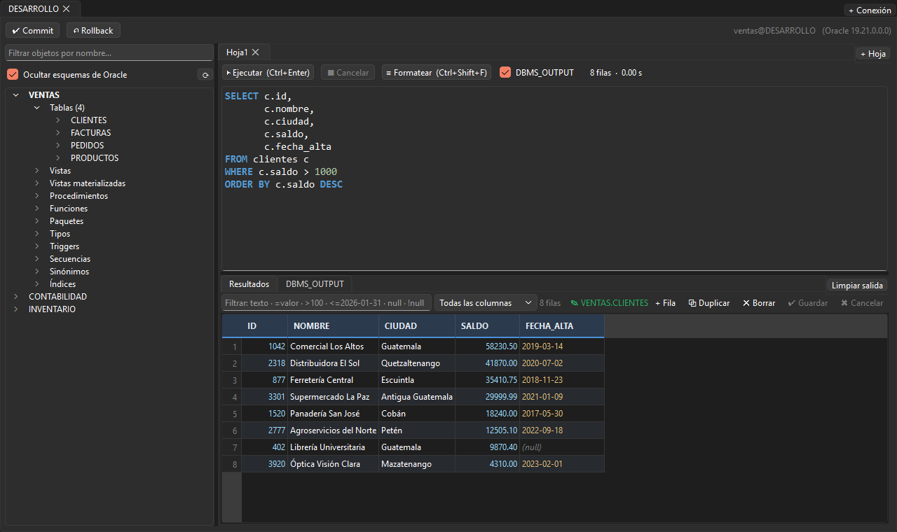
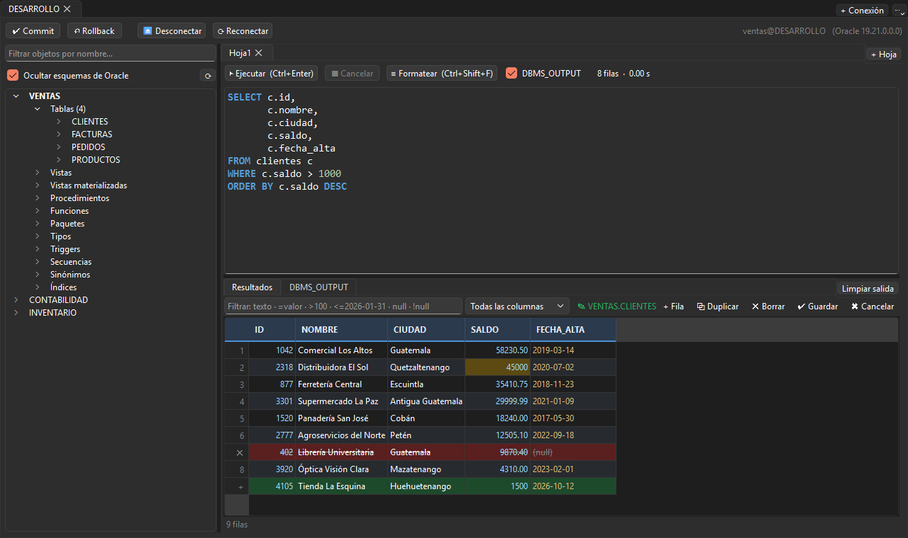
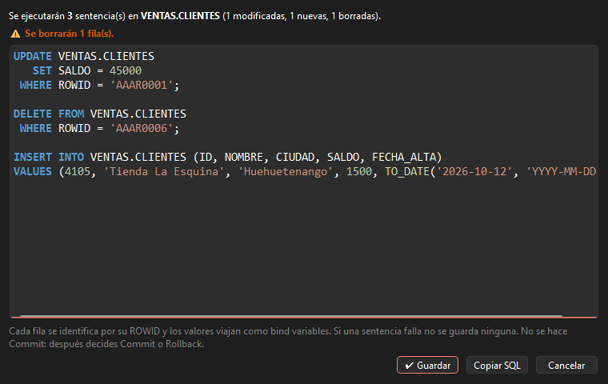
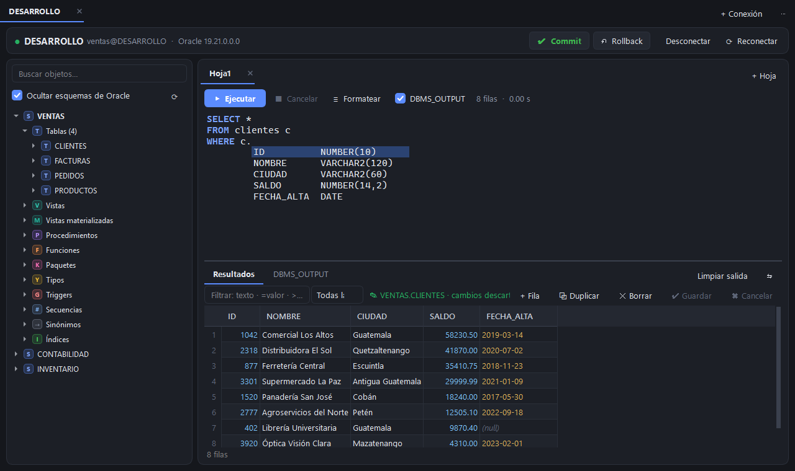
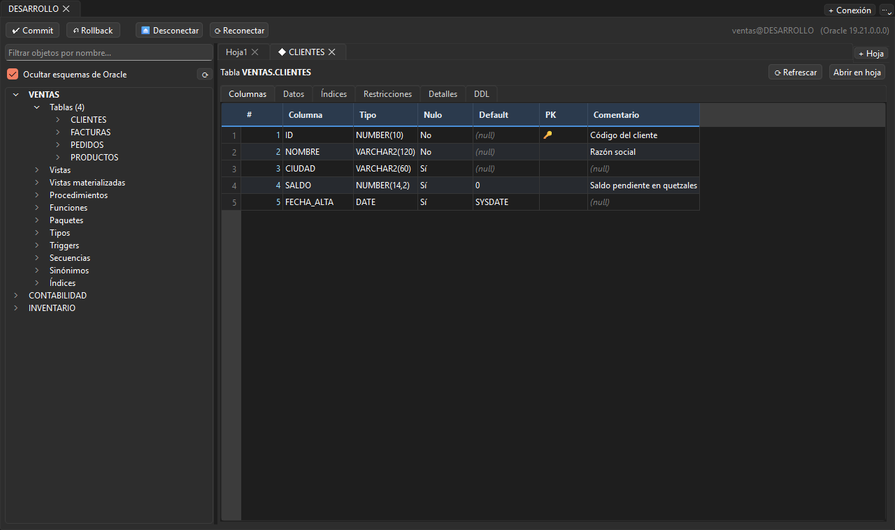
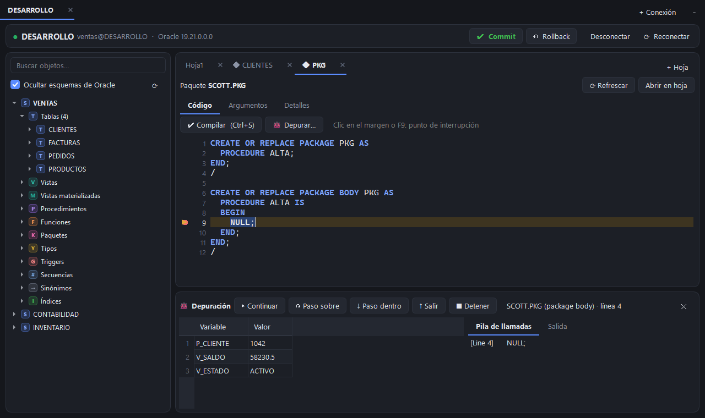

# MiniSQL

[](https://github.com/AndreeAvalos/mini-sql/actions/workflows/tests.yml)


[](LICENSE)

Cliente de escritorio ligero para **Oracle**, hecho con PySide6 y python-oracledb en modo *thin*:
no necesita Oracle Client instalado. Pensado para el trabajo diario con SQL y PL/SQL: hojas de consultas,
explorador de objetos, autocompletado, edición y compilación de paquetes, y depuración paso a paso.



## Funciones

- **Desconectar y reconectar** sin cerrar la pestaña: las hojas quedan abiertas y ⟳ Reconectar abre una sesión
  nueva sin pedir la contraseña. Si Oracle corta la conexión (red, inactividad, sesión terminada) se avisa y se
  ofrece reconectar al ejecutar.
- **Varias conexiones y hojas en pestañas.** Cada conexión tiene su explorador y sus hojas; todas comparten la
  transacción de la conexión, con Commit/Rollback explícitos (autocommit apagado).
- **Editar los resultados** de una consulta de una sola tabla: celdas, filas nuevas y borradas, validando cada
  valor contra la columna (tipo, largo, decimales, NOT NULL). **Guardar** muestra antes las sentencias que se
  van a ejecutar, aplica los cambios por ROWID y quedan pendientes de Commit; **Cancelar** los descarta.
- **Filtrar y ordenar** los resultados: texto libre, `=valor`, `>100`, `<=2026-01-31`, `null`, `!null`.
- **Paginación:** se traen de Oracle **200 filas por página**; ▶ trae la siguiente y «⏬ Todas» el resto (hasta
  100.000). El filtro y el orden se aplican a las filas ya cargadas.
- **Ejecución sin congelar la ventana**, con cancelación y tiempo transcurrido.
  Ctrl+Enter ejecuta la sentencia donde está el cursor (se separan con una línea en blanco). Si ese bloque o la
  selección tiene varias sentencias terminadas en `;` (o bloques PL/SQL terminados en `/`), se ejecutan en orden
  como un script y se detiene en la primera que falla.
- **Confirmaciones de seguridad** antes de `UPDATE`/`DELETE` sin `WHERE`, `DROP`, `TRUNCATE` y DDL con cambios
  pendientes.
- **Autocompletado** de palabras clave, funciones, esquemas, tablas, columnas, paquetes y secuencias. Entiende los
  alias del `FROM`/`JOIN`, sigue sinónimos y agrega el alias al completar una tabla o una columna.
- **Interfaz moderna** con tema oscuro y claro (sigue el modo de Windows o se elige en el menú ⋯ → Tema), íconos
  por tipo de objeto y la letra que prefieras con Ctrl+rueda.
- **Colores de sintaxis** y **formateo** de SQL (Ctrl+Shift+F).
- **Buscar y reemplazar** (Ctrl+F / Ctrl+H) en hojas, código y DDL, con expresiones regulares.
- **DBMS_OUTPUT** en cada hoja; acepta `SET SERVEROUTPUT ON` y `EXEC procedimiento` como en SQL*Plus.
- **Explorador de objetos** con filtro, y **visor** de tablas, vistas, paquetes, procedimientos, secuencias,
  índices…: columnas, datos, índices, restricciones, detalles y DDL. F4 abre el objeto bajo el cursor.
- **Edición y compilación de PL/SQL** con lista de errores que lleva a la línea.
- **Depuración PL/SQL** con breakpoints, pasos (F10/F11/Shift+F11), variables, pila de llamadas y el valor de
  cada variable al pasar el mouse.
- **Nunca se pierde trabajo:** las hojas se guardan solas cada pocos segundos y se recuperan al volver a abrir,
  incluso después de un cierre inesperado.





| Autocompletado con alias | Visor de objetos |
|---|---|
|  |  |



## Descarga (Windows)

Descarga `MiniSQL.exe` de la última versión en [Releases](https://github.com/AndreeAvalos/mini-sql/releases/latest)
y ábrelo: no necesita Python ni Oracle Client. Al ser un ejecutable sin firma digital, Windows SmartScreen puede
avisar la primera vez («Más información» → «Ejecutar de todas formas»).

Guárdalo en una carpeta tuya, por ejemplo `%LOCALAPPDATA%\Programs\MiniSQL\`, para que pueda **actualizarse
solo** (en `Program Files` no tiene permiso para reemplazarse).

### Actualizaciones

Al abrir, MiniSQL revisa una vez al día si hay una versión nueva en Releases y, si la hay, muestra un aviso arriba
de las pestañas: **Novedades**, **Actualizar** u **Omitir esta versión**. Al actualizar:

1. Descarga el `.exe` nuevo y verifica su huella **SHA-256** contra la publicada (si no coincide, no se instala).
2. Corre la autoprueba del `.exe` nuevo (`--self-test`); si falla, no se instala.
3. Reinicia por el cierre normal: si hay cambios sin confirmar o sin guardar te pregunta antes, y las hojas se
   guardan y se recuperan al abrir. Si eliges «más tarde», se instala la próxima vez que cierres MiniSQL.

La versión anterior queda como `MiniSQL.old.exe`: el menú **⋯** (junto a «+ Conexión») tiene «Volver a la versión
anterior», además de «Buscar actualizaciones», «Buscar actualizaciones al abrir», «Incluir versiones de prueba» y
«Acerca de». Sin internet, o si la red bloquea GitHub, no pasa nada: se puede descargar a mano. La revisión solo
consulta la lista pública de versiones; no envía datos de la app ni de tus conexiones.

## Instalación desde el código

Requiere Python 3.10 o superior.

```bash
git clone https://github.com/AndreeAvalos/mini-sql.git
cd mini-sql
python -m pip install -r requirements.txt
python main.py
```

También se puede instalar como paquete, lo que agrega el comando `minisql`:

```bash
python -m pip install .
minisql
```

> **Oracle 11g o anterior:** el modo *thin* necesita Oracle 12.1 o superior. Para versiones antiguas, instala
> Oracle Instant Client y descomenta `oracledb.init_oracle_client(...)` en `minisql/db/__init__.py`.

## Uso

Al abrir aparece el diálogo de conexión. Puedes usar un alias de tu `tnsnames.ora` (indica la ruta del archivo
una vez) o escribir `host:puerto/servicio`. Los perfiles se guardan sin contraseña; la contraseña puede quedar en
el llavero del sistema (Administrador de credenciales de Windows, Keychain de macOS…).

### Atajos

| Atajo | Acción |
|---|---|
| Ctrl+Enter | Ejecutar la sentencia del cursor o el texto seleccionado |
| Ctrl+Espacio | Autocompletar |
| Ctrl+Shift+F | Formatear la sentencia del cursor |
| Ctrl+F / Ctrl+H | Buscar / reemplazar (mayúsculas, palabra completa, expresión regular) |
| Doble clic / F2 en una celda | Editar el valor (vacío = NULL) |
| Ctrl+S en los resultados | Guardar los cambios de la grilla (quedan pendientes de Commit) |
| Ctrl+rueda del mouse | Agrandar o achicar la letra de editores, salidas y resultados (se recuerda) |
| Ctrl+0 | Volver al tamaño de letra normal |
| F3 / Shift+F3 | Siguiente / anterior resultado de la búsqueda |
| F4 | Abrir el objeto cuyo nombre está bajo el cursor |
| Ctrl+T / Ctrl+W | Nueva hoja / cerrar hoja |
| Ctrl+N | Nueva conexión |
| Ctrl+S | Compilar (en la pestaña Código de un objeto) |
| F9 | Poner o quitar breakpoint |
| F5 · F10 · F11 · Shift+F11 · Shift+F5 | Depuración: continuar · paso sobre · paso dentro · salir · detener |
| Doble clic en una pestaña | Renombrar la hoja |

### Depuración PL/SQL

Usa `DBMS_DEBUG`. El usuario necesita el privilegio `DEBUG CONNECT SESSION` y poder depurar el objeto
(ser su dueño, o tener `DEBUG` sobre él o `DEBUG ANY PROCEDURE`). Al iniciar, MiniSQL arma un bloque de prueba con
los argumentos del procedimiento y puede recompilarlo con información de depuración.

## Dónde se guardan los datos

Todo queda en tu carpeta de usuario, en `~/.minisql/`, y **nunca se guardan contraseñas en archivos**:

| Archivo | Contenido |
|---|---|
| `conexiones.json` | Perfiles (nombre, usuario, alias) |
| `config.json` | Ruta del `tnsnames.ora` y preferencias de actualización |
| `actualizaciones/` | Descarga de una versión nueva mientras se instala (se borra sola) |
| `sesion/indice.json` | Conexiones abiertas y orden de las hojas |
| `sesion/<CONEXIÓN>/<hoja>.sql` | El texto de cada hoja (se escribe solo cuando cambia) |
| `minisql.lock` | Evita abrir MiniSQL dos veces (dos ventanas se pisarían el autoguardado) |

## Desarrollo

```bash
python -m pip install -r requirements.txt -r requirements-dev.txt
pytest            # pruebas con conexiones simuladas: no necesitan Oracle
ruff check .      # estilo y errores comunes
python docs/generar_capturas.py   # vuelve a generar las imágenes de este README
```

### Publicar una versión

**Automático:** escribe `[CI]` en el mensaje de un commit a `main` (`[CI minor]` o `[CI major]` para subir el
número del medio o el primero). GitHub Actions (`version.yml`) sube la versión, hace el commit «Versión X.Y.Z»
(después haz `git pull`) y publica. Si el número de `__version__` todavía no se publicó, sale ese mismo.

**A mano:**

1. Sube `__version__` en `minisql/__init__.py` (por ejemplo `0.2.0`; una versión de prueba: `0.3.0-beta.1`) y
   haz commit. Es el único lugar de la versión: pyproject.toml, el .exe y el actualizador la leen de ahí.
2. Crea y sube la etiqueta: `git tag v0.2.0` y `git push origin v0.2.0`.

GitHub Actions corre las pruebas, compila `MiniSQL.exe` con PyInstaller (`packaging/MiniSQL.spec`), lo verifica con
`MiniSQL.exe --self-test` y lo publica en Releases junto con `MiniSQL.exe.sha256` (las etiquetas con `-`, como
`v0.3.0-beta.1`, salen como versión de prueba). Las copias instaladas lo detectan solas. Para compilarlo localmente:
`pip install pyinstaller` y `pyinstaller packaging/MiniSQL.spec`; queda en `dist/`.

El código está organizado en capas: `minisql/sql` (texto SQL, sin Oracle ni Qt), `minisql/db` (todo lo que
habla con Oracle, en hilos) y `minisql/ui` (interfaz Qt). [CLAUDE.md](CLAUDE.md) describe cada módulo y las
reglas que el código debe mantener.

## Licencia

[MIT](LICENSE) © 2026 Andree Avalos
